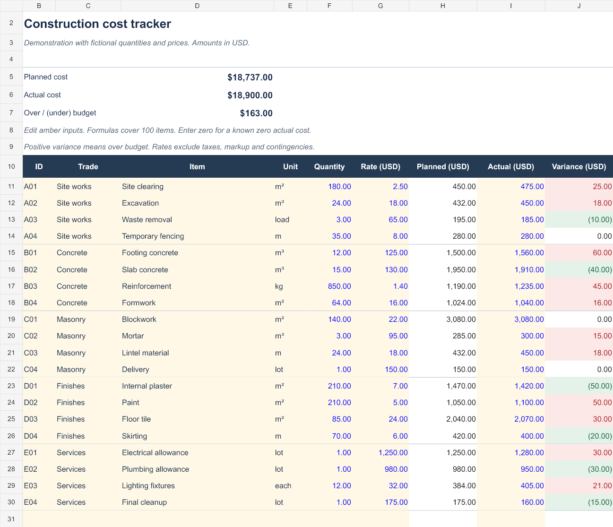

# Construction cost tracker — Excel sample

An Excel sample for comparing a construction project's planned costs with actual spending. All sample quantities, rates and costs are fictional. This is a demonstration, not previous client work.

**[Download the Excel sample](cost-tracker-sample.xlsx)**

## What the workbook shows

- A line-item cost register with descriptions, trades, units, quantities and unit rates.
- Planned cost calculated from quantity × rate.
- Actual cost inputs, budget variance and summary totals.
- Capacity for up to 100 line items for one project and one currency.

The example contains 20 fictional line items. Its planned total is 18,737, actual total is 18,900, and variance is 163 over plan. The sample uses no macros or external data connections.

## Order a customized version

**[View the USD 85 service on Upwork](https://www.upwork.com/services/product/consulting-hr-an-automated-excel-construction-cost-tracker-with-clear-budget-variances-2114430959484163718)**

The listed service covers one project, one currency and up to 100 client-supplied line items, with delivery within three days after all required inputs arrive and one consolidated revision. The current Upwork listing governs availability and terms; publication of this sample does not create a contract.

Clients provide the approved descriptions, units, quantities, rates, actual costs, currency and Excel version. Structural design, drawing takeoffs, market-price research, macros, integrations and tax advice are outside this service's scope.

## Verification and authorship

This sample was prepared with AI assistance. Its totals and selected edge cases were checked, and its rendered layout was reviewed. It has not been tested in desktop Microsoft Excel; please check compatibility with your Excel version before relying on it.

Use the sample to inspect the format with fictional data. Any real construction budget needs its own checked inputs and review before use.
